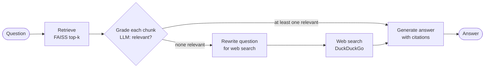

# Corrective RAG

A question-answering app over five machine learning papers, built as a **Corrective RAG (CRAG)** pipeline with LangGraph. It retrieves chunks from the papers, has an LLM grade each chunk for relevance, and falls back to a web search when nothing relevant is found locally. A Streamlit chat UI shows each step as it runs, followed by the cited answer.

## How it works



| Step | What it does |
|---|---|
| **Retrieve** | Finds the top-k most similar chunks in a FAISS index of the papers (500-character chunks, `all-mpnet-base-v2` embeddings). |
| **Grade** | Asks the LLM, chunk by chunk, whether it actually helps answer the question, and drops the ones that don't. |
| **Rewrite** | If no chunk passes, rewrites the question into a keyword-style web search query. |
| **Web search** | Adds the top 5 DuckDuckGo results to the context. |
| **Generate** | Answers only from the remaining context and cites each claim, e.g. `[1706.03762v7.pdf, p. 4]` or a URL. |

## Papers in the index

| File | Paper |
|---|---|
| `1706.03762v7.pdf` | Attention Is All You Need (Transformer) |
| `2005.11401v4.pdf` | Retrieval-Augmented Generation for Knowledge-Intensive NLP Tasks (RAG) |
| `2210.03629v3.pdf` | ReAct: Synergizing Reasoning and Acting in Language Models |
| `2310.11511v1.pdf` | Self-RAG: Learning to Retrieve, Generate, and Critique through Self-Reflection |
| `2401.15884v3.pdf` | Corrective Retrieval Augmented Generation (CRAG) |

To use your own papers, put PDFs in the project folder and delete `faiss_index/` (locally) or rebuild the image (Docker).

## Quick start with Docker

You need [Docker](https://docs.docker.com/get-docker/) and a free [Groq API key](https://console.groq.com/keys).

1. Create a `.env` file in the project folder. **Don't put quotes around the value**, because Docker's `--env-file` passes them through literally:

   ```
   GROQ_API_KEY=your_key_here
   ```

2. Build the image and run it:

   ```bash
   docker build -t corrective-rag .
   docker run --rm -p 8501:8501 --env-file .env corrective-rag
   ```

3. Open <http://localhost:8501>.

The image downloads the embedding model and builds the FAISS index during the build, so the first build takes a few minutes and the container answers immediately once started.

## Run locally

Requires Python 3.14 and [uv](https://docs.astral.sh/uv/).

```bash
uv sync
uv run streamlit run src/corrective_rag/app.py
```

On the first run the app embeds all the PDFs and saves the index to `faiss_index/`; later runs load it from disk.

The notebook [`corrective_RAG.ipynb`](corrective_RAG.ipynb) has the same pipeline built step by step, with a set of test questions that exercise both branches.

## Configuration

All settings are environment variables (for example in `.env`):

| Variable | Default | Purpose |
|---|---|---|
| `GROQ_API_KEY` | (required) | Groq API key for the LLM |
| `GROQ_MODEL` | `qwen/qwen3.8-27b` | Groq model used for grading, rewriting and answering |
| `EMBEDDING_MODEL` | `sentence-transformers/all-mpnet-base-v2` | Hugging Face embedding model |
| `TOP_K` | `4` | Chunks retrieved per question |
| `DATA_DIR` | project folder | Folder with the PDFs to index |
| `INDEX_DIR` | `faiss_index/` | Where the FAISS index is saved |

If you change `EMBEDDING_MODEL`, delete the saved index so it's rebuilt with the new model.

## Project structure

```
├── src/corrective_rag/
│   ├── pipeline.py      # vector store, prompts, LangGraph nodes and graph
│   └── app.py           # Streamlit chat UI
├── corrective_RAG.ipynb # development notebook
├── *.pdf                # the indexed papers
├── Dockerfile
└── pyproject.toml       # dependencies (managed with uv; CPU-only PyTorch)
```

## Tech stack

LangGraph · LangChain · Groq · FAISS · sentence-transformers · DuckDuckGo search (`ddgs`) · Streamlit · uv · Docker
